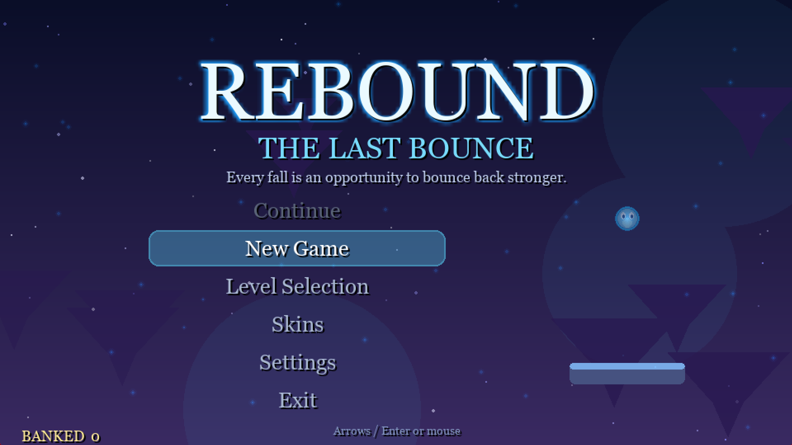
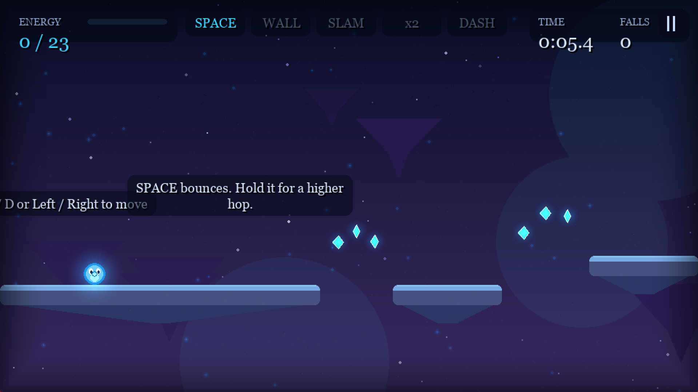
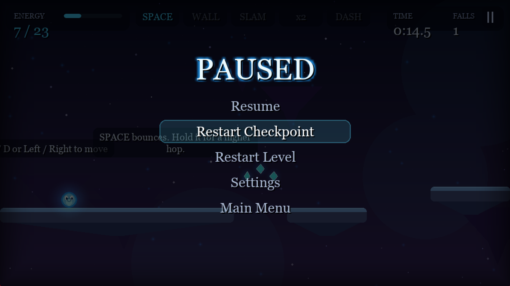

# REBOUND: The Last Bounce

*Every fall is an opportunity to bounce back stronger.*

REBOUND is a small single-player platform game made with Python and Pygame. You control a glowing energy orb and make your way through five worlds built around one central mechanic: bouncing. The game uses the idea behind the **“Bounce Back!”** theme directly in its movement and level design. Falling costs time and adds to your fall count, but checkpoints let you recover and keep climbing.

I wanted the game to feel like a complete little arcade adventure rather than a one-screen bouncing demo. That is why it includes a short story, five themed levels, abilities to unlock, collectible energy, save data, a skin shop, sound and music, and menus for continuing or selecting levels.

## Screenshots

These screenshots are from the game running locally.

### Main menu



### In-game level



### Pause menu



## How to play

Move REO across platforms, collect the energy placed around each level, activate Rebound Stations, and reach the exit. Some platforms move, crumble, disappear, or launch the player higher. Other hazards need to be timed or avoided. Later levels introduce abilities that make longer and more difficult routes possible.

The five levels are:

1. **The Fall** – Learn the basic bounce, collect energy, and use the first Rebound Stations.
2. **The Forgotten Forest** – Find an ability shrine and learn Wall Rebound.
3. **The Collapsed Machine** – Deal with mechanical hazards and unlock Power Bounce.
4. **The Frozen Void** – Handle slippery platforms and unlock Double Bounce.
5. **The Last Rebound** – Combine the abilities and obstacles from the earlier levels, then reach the end.

### Abilities

- **Basic Bounce:** Hold the jump key for a higher hop.
- **Wall Rebound:** Bounce away from a wall to reach another platform.
- **Power Bounce:** Slam down in mid-air; landing creates a powerful rebound.
- **Double Bounce:** Use a second jump while airborne.
- **Energy Dash:** Burst horizontally to cross gaps.

Energy fragments are collected during levels. Finishing levels adds energy to the bank, which can be spent on orb skins. The game tracks level unlocks, best times, collected Core fragments, abilities, settings, and an in-progress run in a local JSON save file.

## Controls

| Key | Action |
|---|---|
| `A` / `D` or `Left` / `Right` | Move |
| `Space` / `W` / `Up` | Jump or bounce (hold for a higher hop) |
| `S` / `Down` | Power Bounce slam (after unlocking it) |
| `Shift` | Energy Dash (after unlocking it) |
| `E` | Interact with an ability shrine |
| `Esc` / `P` | Pause |
| `F11` | Toggle fullscreen |

The menu can be navigated with the keyboard or mouse.

## Tech stack

- **Python 3** – game logic and application code.
- **Pygame 2.5 or newer** – window, input, drawing, timing, and audio playback.
- **Python standard library** – `asyncio`, `json`, `math`, `random`, `array`, `os`, and `sys` for the game loop, save data, calculations, procedural audio samples, and platform handling.

There are no external image or audio asset folders in this version. The orb, platforms, backgrounds, particles, interface, sound effects, and layered music are drawn or generated by the Python code. Pygame's mixer is initialized for audio; if audio cannot initialize on a device, the game is designed to continue without it.

## Run locally

You need Python 3 and pip installed.

### Windows (PowerShell)

```powershell
cd REBOUND
py -m venv .venv
.venv\Scripts\Activate.ps1
py -m pip install -r requirements.txt
py main.py
```

If PowerShell blocks virtual-environment activation, you can run the commands without activating it:

```powershell
py -m venv .venv
.venv\Scripts\python.exe -m pip install -r requirements.txt
.venv\Scripts\python.exe main.py
```

### macOS / Linux

```bash
cd REBOUND
python3 -m venv .venv
source .venv/bin/activate
python -m pip install -r requirements.txt
python main.py
```

`requirements.txt` contains the only third-party dependency:

```text
pygame>=2.5.0
```

The game opens in a 960 × 540 window. On first launch, it creates `rebound_save.json` beside `main.py` to store progress and settings. Keep that file if you want to keep your local save; delete it to start with a fresh save.

## Development and debugging

The source is kept in one main file, `main.py`. The level layouts are built in code, and the five level-builder functions are `level1()` through `level5()`.

A debug mode is included for development. Start it with:

```bash
python main.py --debug
```

In debug mode, `F1` enables god mode, `F2` unlocks all abilities, and `F3` jumps to the level exit. These are testing shortcuts, not required for normal play.

There is also a level-construction check:

```bash
python main.py --check
```

It builds each of the five levels in check mode and prints `All levels OK` if they pass. This command still requires Pygame to be installed because the game module imports it at startup.

## Things that needed care

The trickiest part of this project is making the movement feel responsive without making the physics unpredictable. The player controller uses separate ground and air acceleration, friction, gravity, a terminal fall speed, and different bounce strengths. It also includes a short coyote-time window and jump buffering so a jump input close to a platform edge or landing is less likely to be ignored.

The level objects need different collision and timing behaviour too. Moving platforms, fragile and timed platforms, ice, springs, power platforms, spikes, rotating hazards, barriers, and wind zones all affect how a jump has to be planned. Checkpoints and the saved in-progress run also need to agree so that restarting after a fall does not throw away the player's whole run.

Audio was another part of the implementation: the sound effects and music layers are generated in code rather than loaded from separate audio files. The mixer can fail to initialize on some systems, so audio setup is guarded and the game can still run without sound.

## Project files

```text
REBOUND/
├── main.py
├── requirements.txt
├── README.md
├── rebound_save.json       # created automatically when the game runs
└── docs/
    └── images/
        ├── main-menu.png
        ├── gameplay.png
        └── pause-menu.png
```

## Project status

The current project contains five playable themed levels, the ability progression, collectibles, checkpoints, skins, menus, settings, save data, and generated audio. The screenshots above show the menu, a live level, and the pause screen.

**Fall. Learn. Bounce Back.**
